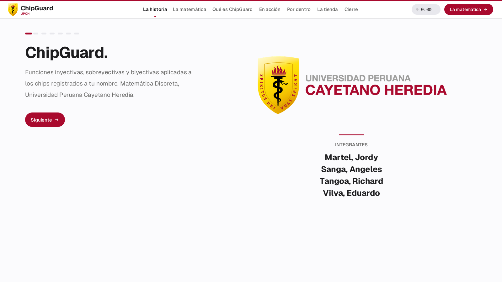
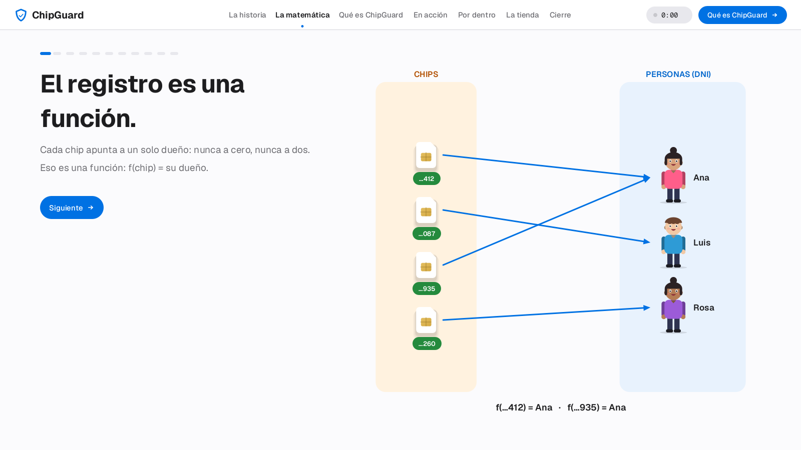
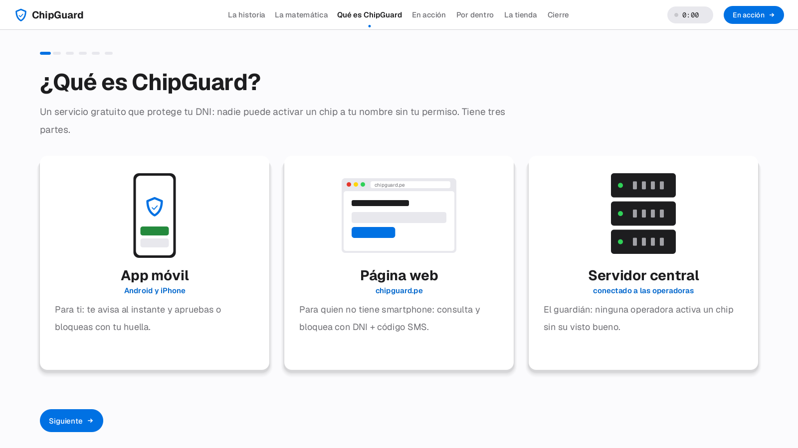
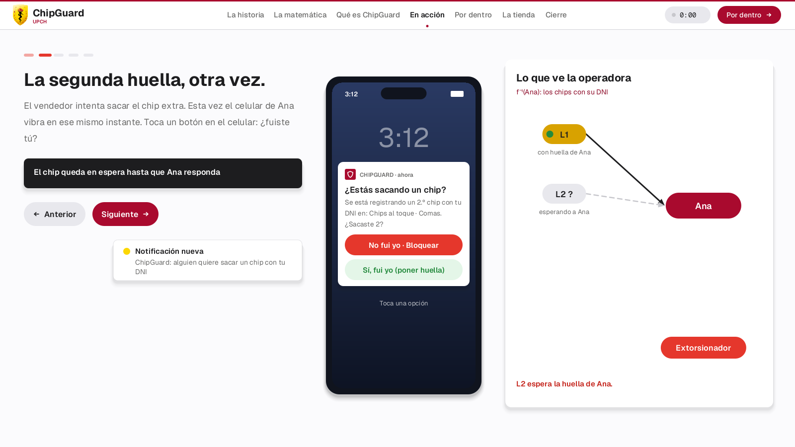
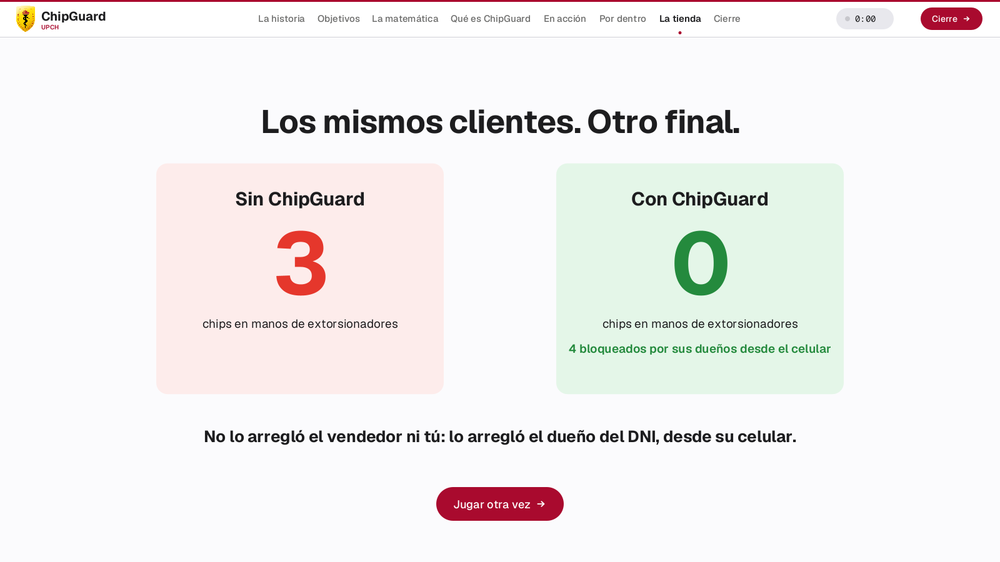

<p align="center">
  
</p>

<h1 align="center">ChipGuard — ¿a quién le pertenece tu chip?</h1>

<p align="center">
  Exposición de <b>Matemática Discreta</b> · Universidad Peruana Cayetano Heredia<br>
  Funciones inyectivas, sobreyectivas y biyectivas aplicadas a las líneas móviles registradas a nombre de terceros en el Perú.
</p>

<p align="center">
  <a href="https://github.com/jordymartel-hash/ChipGuard/releases/latest/download/ChipGuard-Windows.zip"><b>⬇ Descargar para Windows</b></a>
  &nbsp;·&nbsp;
  <a href="https://github.com/jordymartel-hash/ChipGuard/releases/latest">Todas las descargas</a>
  &nbsp;·&nbsp;
  <a href="#informe">Informe completo (PDF)</a>
</p>

---



## ¿De qué trata?

A Ana le piden poner la huella «otra vez» al comprar un chip, y con esa segunda huella registran otro chip a su nombre.
Ese chip termina en manos de un extorsionador y la policía, siguiendo el registro, llega a Ana.

El registro de la operadora es una **función** que asigna a cada chip un dueño. El problema es que *dueño registrado ≠ quien
lo usa*. **ChipGuard** es una propuesta: ningún chip se activa con tu DNI sin que lo apruebes desde tu celular.

## Descargar y abrir

| Sistema | Cómo |
|---|---|
| **Windows** | Descarga [`ChipGuard-Windows.zip`](https://github.com/jordymartel-hash/ChipGuard/releases/latest/download/ChipGuard-Windows.zip), descomprímelo y abre **`Abrir ChipGuard.bat`**. Ya trae Java incluido, no necesitas instalar nada. |
| Linux / macOS / Windows con Java 17+ | Descarga [`ChipGuard.jar`](https://github.com/jordymartel-hash/ChipGuard/releases/latest/download/ChipGuard.jar) y ejecuta `java -jar ChipGuard.jar` |

Si Windows muestra «Windows protegió su PC», pulsa **Más información → Ejecutar de todas formas** (la app no está firmada).

**Controles:** las flechas ← → avanzan entre escenas y capítulos. El cronómetro arranca o se pausa con un clic, y se reinicia con clic derecho.

## Capítulos

1. **La historia:** el caso de Ana (la doble huella, el chip extra, la extorsión y la policía).
2. **La matemática:** función, inyectiva, sobreyectiva y biyectiva con casos reales; registro ≠ uso real; principio del palomar.
3. **Qué es ChipGuard:** app + web + servidor, usos, actores, pantallas y comparación con «Checa tus líneas» de OSIPTEL.
4. **En acción:** la alerta llega al celular.
5. **Por dentro:** la arquitectura y el flujo de 7 pasos.
6. **La tienda:** un juego en 2 rondas, sin y con ChipGuard (de 3 chips en manos criminales a 0).
7. **Cierre:** conclusiones y referencias APA.

| | |
|---|---|
|  |  |
|  |  |

## Equipo

**Docente:** Dr. Ing. CIP. Illesca Cangalaya, Omar Felix · ORCID [0000-0002-0144-6878](https://orcid.org/0000-0002-0144-6878)

| Integrante | ORCID |
|---|---|
| Martel Vasquez, Jordy Joel | [0009-0008-6410-8615](https://orcid.org/0009-0008-6410-8615) |
| Sanga Limache, Angeles Jemina | [0009-0003-7669-4168](https://orcid.org/0009-0003-7669-4168) |
| Tangoa Alva, Richard José Hernan | [0009-0006-4441-0185](https://orcid.org/0009-0006-4441-0185) |
| Vidalon Ampudia, Eduardo Josias | [0009-0008-2704-013X](https://orcid.org/0009-0008-2704-013X) |

## Desarrollo

Java 17+ puro (Swing, sin librerías externas). Tipografía Geist incluida.

```bash
./probar.sh                                                              # compila y corre las 141 pruebas
./ejecutar.sh                                                            # abre la app desde el código
java -Djava.awt.headless=true -cp out:recursos simuchip.Capturas capturas  # regenera las capturas
python3 informe/generar.py                                               # regenera el informe PDF
./empaquetar.sh                                                          # crea ChipGuard.jar
```

## Informe

El informe completo (25 páginas, referencias en formato APA) explica el modelo matemático, la propuesta y los resultados de la simulación:

**[📄 Informe-ChipGuard.pdf](docs/Informe-ChipGuard.pdf)** (también está en la [release](https://github.com/jordymartel-hash/ChipGuard/releases/latest)).
